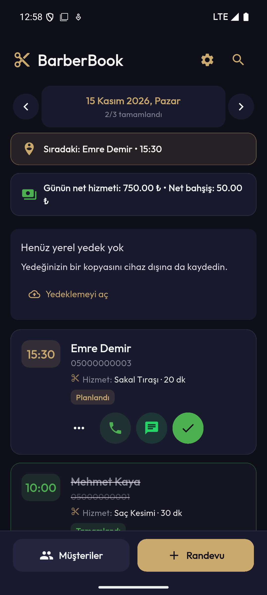
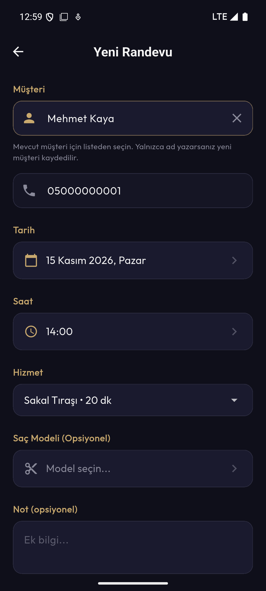
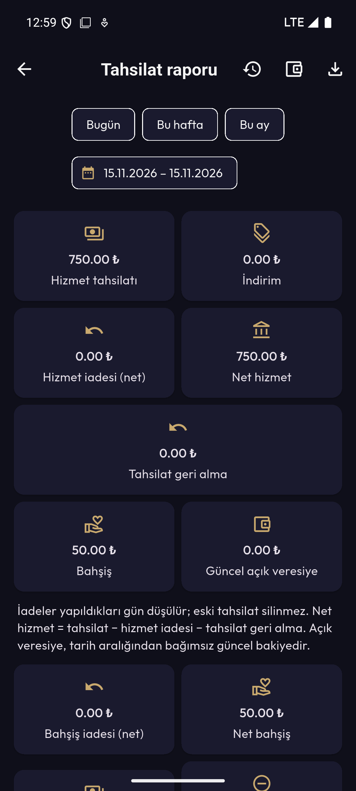

# BarberBook — Berber Randevu ve Kasa Defteri

Tek bir berber dükkânının müşteri, randevu ve kasa kaydını telefonda tutması için yazılmış bir Android uygulaması (Flutter). Kâğıt defter ve telefon rehberiyle çalışan küçük dükkânlar için: kim ne zaman gelecek, kime ne kadar veresiye yazıldı, gün sonunda kasada ne olmalı. Hesap ve sunucu yok; veriler telefondaki yerel veritabanında (SQLite) kalır.

> **Portföy sürümü.** Dükkâna teslim edilen sürümdeki lisans ve destek kodu bu depodan çıkarıldı. Android'de `com.barberbook.portfolio` kimliğiyle **BarberBook Demo** adıyla, asıl uygulamadan ayrı kurulur.
>
> **Gerçek telefonda test edilmedi.** Uygulama yalnızca otomatik testlerle ve Android emülatörde denendi. Gerçek bir dükkânda kullanım geri bildirimi de henüz yok.

<p>
  
  
  
</p>

Ekran görüntülerindeki müşteriler, telefon numaraları ve tutarlar kurgusaldır (emülatörde demo veriyle alındı). [41 saniyelik kullanım videosu](docs/demo.mp4) — emülatör kaydı, 2× hızlandırılmış.

## Ne yapıyor?

- **Müşteriler:** kayıt, arama, randevu geçmişi. Müşteri kartı silinse de geçmiş randevular kalır.
- **Randevular:** günlük takvim; durumlar (planlandı, tamamlandı, iptal, gelmedi); hizmet süresine göre çakışma kontrolü; haftalık çalışma saatleri ve kapalı zamanlar.
- **Hizmetler:** ekleme, düzenleme, arşivleme; süre ve isteğe bağlı fiyat.
- **Kasa:** tamamlanan randevuda nakit, kart, FAST/havale veya veresiye; indirim, bahşiş ve not. Bugün / bu hafta / bu ay / seçilen tarih aralığı raporu ve CSV dışa aktarma.
- **Veresiye:** açık veresiye listesi, kısmi veya tam tahsilat; borçtan fazla tahsilat engellenir.
- **Düzeltmeler:** iade, borçtan düşme ve hatalı tahsilatı geri alma, eski kaydı silmeden gerekçeli yeni bir hareketle yapılır.
- **Yedek:** veritabanı ve müşteri fotoğraflarını içeren ZIP yedeği; geri yüklemeden önce dosya kontrol edilir ve mevcut verinin güvenlik yedeği alınır. Son yedek 7 günden eskiyse ana ekranda hatırlatma görünür (otomatik yedek almaz).
- **Hatırlatma:** randevu için telefonda yerel alarm. WhatsApp'ta hazır mesajı açar; mesajı göndermeyi kullanıcı yapar, uygulama otomatik mesaj göndermez.
- **Saç modeli galerisi:** 11 örnek görsel. Bu görseller yapay zekâ ile üretildi, gerçek kişiler değildir ([liste](assets/hairstyles/KAYNAK.md)).

Kapsam dışı: çevrim içi rezervasyon, online ödeme, birden çok işletme, harita.

## Çalıştırma

Flutter SDK gerekir (CI 3.38.5 kullanır).

```bash
flutter pub get
flutter run
```

**Hazır APK (süreli):** [GitHub Actions](https://github.com/sevketsekerciler63/barberbook/actions/workflows/ci.yml) her başarılı çalıştırmada `barberbook-demo-debug` adlı bir ZIP üretir: telefon için ARM64, emülatör için x86_64 debug APK ve `SHA256SUMS.txt`. GitHub bu dosyaları **yalnızca 14 gün** saklar. Son çalıştırma 14 günden eskiyse indirilecek dosya görünmez; o durumda yukarıdaki komutlarla kendiniz derleyin. [İndirme ve dosya doğrulama](docs/ci.md).

## Ne test edildi, ne edilmedi?

- **Otomatik testler:** 243 test (modeller, gerçek SQLite veritabanı, şema yükseltmeleri, yedek/geri yükleme, ödeme düzeltmeleri ve önemli ekran akışları). Her gönderimde GitHub Actions'ta biçim kontrolü, `flutter analyze` ve `flutter test` çalışır.
- **Emülatörde elle denendi:** Android 16 emülatörde ana ekran, takvim, randevu formu, yedekleme ve randevu işlemleri; dar ekran ve büyük yazı boyutuyla. [Notlar](docs/emulator-usability-2026-11-10.md).
- **Denenmedi:** gerçek telefon ([kabul planı ve boş sonuç formu](docs/device-acceptance.md)), telefon yeniden başlatılınca ve arka planda alarmın çalması, imzalı sürüm güncellemesi, gerçek dükkânda günlük kullanım.

## Bilinen sınırlar

- Yedek dosyası telefonun içinde durur; yedeği dışarı paylaşmadıysanız telefon kaybolunca veri de gider.
- WhatsApp hatırlatma kontrolü yalnız uygulama açıkken çalışır.
- Aynı isimli müşteriler otomatik birleştirilmez; randevu eklerken mevcut müşteriyi listeden seçmek gerekir.

Teknik ayrıntılar: [mimari](docs/architecture.md) · [ödeme düzeltmeleri](docs/payment-corrections.md) · [tahsilat düzeltme](docs/collection-corrections.md) · [kesinti kurtarma](docs/recovery-2026-10-31.md) · [yedek hatırlatma](docs/backup-reminders.md) · [yedek dosya hataları](docs/backup-file-actions-2026-11-03.md) · [WhatsApp hatırlatmaları](docs/reminders-2026-11-03.md) · [kayıt ve açılış güvenliği](docs/recoverable-forms-and-startup.md)

## Nasıl geliştirdim

Bu uygulamayı yapay zekâ asistanlarıyla birlikte yazdım. Neyin yapılacağına ve neyin kapsam dışı kalacağına ben karar verdim, kodun çoğunu asistan yazdı. Her değişiklikten sonra testler ve analiz çalıştırıldı; bunlar gerçek telefon ve işletme denemesinin yerini tutmaz.

## Lisans

Tüm hakları saklıdır. Kaynak kod yalnızca inceleme amacıyla herkese açıktır; kullanım lisansı verilmemiştir.
