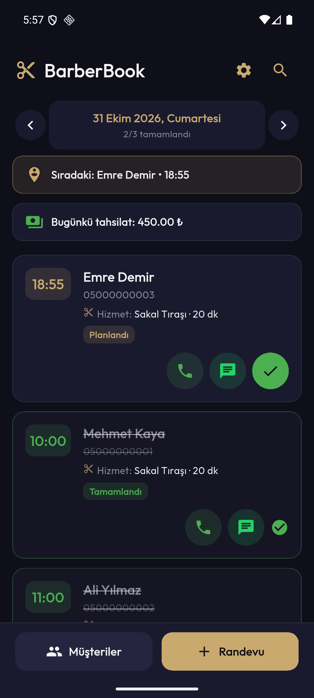
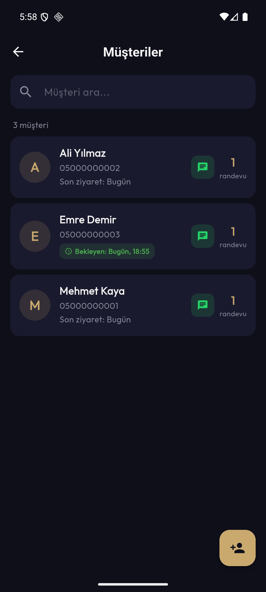
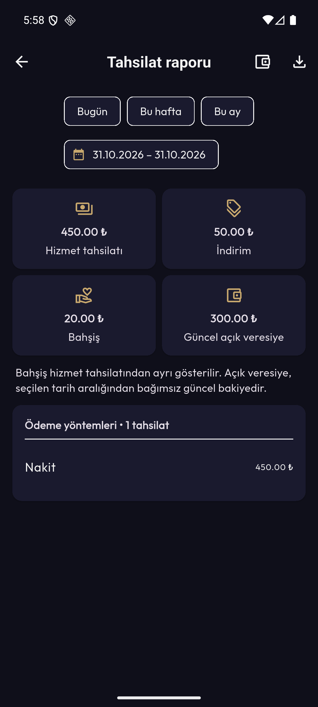

# BarberBook — Berber Randevu Takip Uygulaması

Tek bir berber dükkânının müşteri, randevu ve kasa kaydını telefonunda tutması için yazılmış Flutter uygulaması. Hesap ve sunucu yok, veriler cihazdaki SQLite veritabanında kalır.

> **Bu, portföy sürümüdür.** Uygulamanın dükkâna teslim edilen sürümündeki lisans ve destek kodu (gömülü lisans anahtarı üreticisi ve destek telefonu) bu depodan çıkarıldı; geçmiş de sıfırdan başlıyor. Geri kalan her şey aynı çalışıyor. Gerçek bir dükkânda uzun süreli kullanım geri bildirimi henüz yok.

[41 saniyelik kullanım videosu](docs/demo.mp4) — gerçek Android emülatör kaydı, kurgu veriler; 2× hızlandırılmış. Müşteri geçmişi, rapor ve kısmi veresiye tahsilatı gösterilir.

## Neyi çözüyor?

Küçük bir berber dükkânı kâğıt defter ve telefon rehberiyle çalışıyor: kim ne zaman gelecek, kime ne kadar veresiye yazıldı, gün sonunda kasada ne olmalı. Uygulama bunları tek yerde tutuyor: randevu çakışmasını engelliyor, tamamlanan işte tahsilatı kaydediyor (nakit, kart, havale veya veresiye) ve veresiyeyi kısmi ya da tam tahsil edilebilir tutuyor.

<p>
  
  
  
</p>

Ekran görüntülerindeki müşteriler, telefon numaraları ve tutarlar tamamen kurgusaldır (emülatörde demo veriyle alındı).

## Mevcut özellikler

- Müşteri kaydı, kimliğe göre açık seçim, arama ve randevu geçmişi
- Günlük randevu takvimi
- Randevu durumları: planlandı, tamamlandı, iptal edildi, gelmedi
- Hizmet seçimi, hizmet süresi ve opsiyonel fiyat alanı
- Hizmet ekleme, düzenleme, arşivleme ve yeniden etkinleştirme
- Hizmet süresine göre aralık çakışması kontrolü
- Haftalık çalışma saatleri ve tarih-saat bazlı kapalı zamanlar
- Randevunun çalışma aralığına ve kapalı zamanlara göre doğrulanması
- Yerel SQLite veritabanı ve geriye uyumlu migration
- Müşteri kartı silinse bile randevu geçmişinin korunması
- Uygulama içinden SQLite verisi ve yönetilen müşteri fotoğraflarını içeren ZIP yedek oluşturma ve geri yükleme
- Tamamlanan randevuda nakit, kart, FAST/havale veya veresiye tahsilat kaydı
- Gerçek alınan tutar, indirim, bahşiş ve ödeme notu
- Günlük/haftalık/aylık/özel aralık tahsilat raporu ve CSV dışa aktarımı
- Açık veresiye listesi, kısmi/tam tahsilat ve fazla tahsilat koruması
- Yerel alarm/hatırlatma
- WhatsApp'ta hazır mesaj bağlantısı açma
- Saç modeli galerisi

## Ürün sınırı

Bu sürüm tek işletme ve yerel cihaz kullanımı içindir. Marketplace, harita, çevrim içi müşteri rezervasyonu, online ödeme alma ve çoklu işletme hesabı henüz kapsamda değildir.

## Çalıştırma

```bash
flutter pub get
flutter run
```

## Doğrulama

```bash
dart format lib test
flutter test
flutter analyze
flutter build apk --debug --target-platform android-x64 --split-per-abi
```

2026-10-31: 127 test başarılı, analyzer temiz. Model, gerçek SQLite, migration, yedekleme ve kritik widget akışları test edilir. Otomatik testler, fiziksel cihaz/işletme kabulünün yerini tutmaz.

## Günlük kullanım

1. Hizmetleri ve çalışma saatlerini yönetim menüsünden düzenleyin.
2. Randevu eklerken mevcut müşteriyi arama listesinden seçin. Yalnız isim yazmak yeni müşteri oluşturur; aynı isimli kişiler otomatik birleştirilmez.
3. Randevu tamamlanırken hizmet bedeli, indirim, bahşiş ve ödeme yöntemini girin. Hizmet tutarı = indirim öncesi bedel − indirim; bahşiş ayrıca kaydedilir.
4. Veresiye seçimi kasaya tahsilat yazmaz. **Yönetim → Açık veresiyeler** üzerinden kısmi veya tam tahsilat ekleyin. Aynı listeye tahsilat raporundaki cüzdan simgesinden de ulaşılır.
5. Veresiye kaydı sonradan ödeme formuyla değiştirilmez; tahsilatlar ayrı kasa hareketleri olarak tutulur. Rapor hizmet tahsilatını ve bahşişi ayrı gösterir; güncel veresiye seçilen rapor tarihinden bağımsızdır.
6. Yedekleme menüsünden fotoğraflı ZIP yedeği oluşturup cihaz dışına paylaşın. Geri yüklemeden önce içerik doğrulanır ve mevcut verinin güvenlik yedeği alınır. Sonrasında eski cihaz alarmları temizlenir ve geri gelen gelecekteki planlı randevular için yeniden kurulur. Alarm kurulumu başarısız olursa veriler korunur ve alarmlar için yeniden deneme sunulur.

Tahsil edilmiş ödeme, randevu sonradan iptal edilse veya yeniden planlansa da gerçek tahsilat gününün kasasında kalır; durum değiştirmek para iadesi oluşturmaz. Müşteri telefonu ana ekran ve aramada her yenilemede güncel kayıttan okunur.

Alınmış ödeme ve veresiye ana kaydı yeniden yazılmaz. Ödenmiş randevu tekrar planlanıp tamamlandığında ilk tahsilat korunur; yeni ödeme penceresi açılmaz. İade/düzeltme defteri bu sürümün kapsamına dahil değildir.

Yedek oluşturulunca, dosya geri yükleme kurallarıyla doğrulanır. Eksik fotoğraflarda işlem durur; isterseniz açık onayla yalnız dışa aktarılan kopyadaki eksik bağlantılar çıkarılır. Aynı seçim geri yükleme öncesi güvenlik yedeği için de sunulur. Cihazdaki asıl kayıtlar sırf yedek almak için değiştirilmez. Arşiv sınırı 10.000 girdi (DB/manifest dahil) ve 200 MB açılmış içeriktir; sınır aşımı başarı diye bildirilmez.

Normal randevu kaydında alarm kurulamazsa uyarı ve yeniden deneme sunulur. Aynı dakikadaki randevular, native paketin aynı saniyeyi değiştirme davranışı nedeniyle dakika içinde ayrı saniyelere dağıtılır; saat alanı dakika çözünürlüğündedir.

[Mimari ve teknik kararlar](docs/architecture.md) · [Son düzeltmelerin doğrulaması](docs/followup-acceptance-2026-10-31.md)

## WhatsApp davranışı

Toplu kampanya ekranı kaldırıldı; müşteri bazlı manuel mesaj ve uygulama içi randevu hatırlatması korunur. Hazır mesajın bağlantısı dış uygulamada açılır; mesajı göndermeyi kullanıcı tamamlar. Açma başarısızsa hatırlatma beklemede kalır. Başarılı bağlantı açma, mesajın gönderildiğini veya teslim edildiğini kanıtlamaz. WhatsApp hatırlatma kontrolü uygulama açıkken çalışır; yerel randevu alarmı ayrı bir özelliktir.

## Veri ve güvenlik notları

- Uygulama verileri cihazdaki SQLite veritabanında tutulur.
- Yeni yedekler uygulamanın yerel veritabanı alanındaki `backups` klasöründe `.zip` olarak tutulur; ZIP içinde SQLite veritabanı, fotoğraflar ve bütünlük bilgili bir manifest bulunur. Eski `.db` yedekleri fotoğraf içermeden doğrulanıp geri yüklenmeye devam eder. Geri yükleme öncesinde mevcut verinin otomatik güvenlik yedeği alınır.
- WhatsApp özelliği otomatik mesaj göndermez; hazırlanmış mesajı WhatsApp uygulamasında açar.

GitHub Actions, testlerden sonra ARM64 ve x86_64 debug APK üretir. Son başarılı çalıştırmanın **barberbook-demo-debug** artifact'ı 14 gün indirilebilir: [CI çalıştırmaları](https://github.com/sevketsekerciler63/barberbook/actions/workflows/ci.yml).

## Android çıktısı

```bash
flutter build apk --debug --target-platform android-arm64,android-x64 --split-per-abi --no-pub
```

- ARM64: `build/app/outputs/flutter-apk/app-arm64-v8a-debug.apk`
- Emülatör x86_64: `build/app/outputs/flutter-apk/app-x86_64-debug.apk`
- Üretim imzalı teslim ayrı bir dağıtımdır; debug APK onun yerine otomatik kurulmaz.

## Nasıl geliştirdim

Bu uygulamayı yapay zekâ asistanlarıyla birlikte yazdım. Neyin yapılacağına ve neyin kapsam dışı kalacağına (çevrim içi rezervasyon, online ödeme, çoklu işletme yok) ben karar verdim, kodun çoğunu asistan yazdı. Her değişiklikten sonra testler ve analiz çalıştırıldı; fiziksel cihaz ve işletme kabulünün yerini tutmadıkları yukarıda yazıyor.

## Lisans

Tüm hakları saklıdır. Kaynak kod yalnızca inceleme amacıyla herkese açıktır; kullanım lisansı verilmemiştir.
