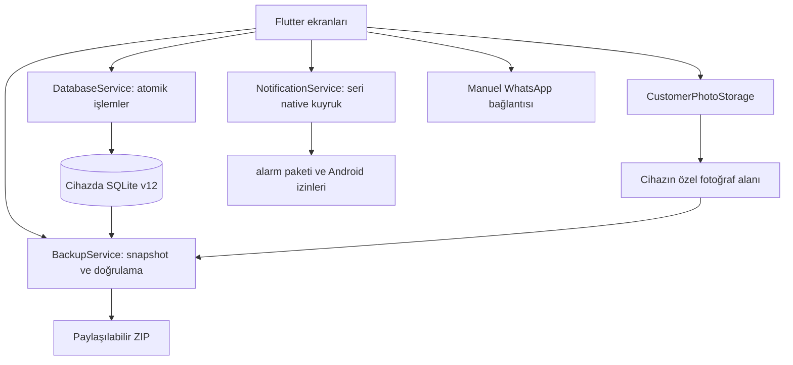

# Mimari ve teknik kararlar

- **Tek işletme, yerel cihaz:** hesap veya sunucu gerektirmez; cihazlar arasında otomatik senkronizasyon yok. SQLite ve yönetilen fotoğraflar uygulamanın özel alanındadır. Cihaz kaybına karşı ZIP'in cihaz dışına paylaşılması gerekir.
- **Kimlikler:** müşteri isimleri benzersiz kabul edilmez. Mevcut müşteri açıkça kimliğiyle seçilir; yeni isim girişi ayrı kayıt oluşturur.
- **Atomik kayıt:** müşteri çözümleme/telefon değişimi, randevu ve istatistikler tek SQLite transaction'ında saklanır. Profil ve yeni fotoğraf geçmişi de birlikte kaydedilir. Kapasite yazım sırasında yeniden kontrol edilir. İşlem içindeki hata kısmi kayıt bırakmaz.
- **Para:** tüm tutarlar tamsayı kuruş. İlk ödeme kaydı veresiye veya tahsil edilmiş olarak saklanır; bilinen finansal kayıt sonradan form üzerinden değiştirilemez. Veresiye tahsilatları ayrı, eklemeli hareketlerdir. Randevu durumu para iadesi oluşturmaz. Tam iade/düzeltme akışı henüz yoktur.
- **Rapor tarihi:** tahsilat randevu gününe değil ödeme/gerçek tahsilat hareketi gününe yazılır. Yerel takvim günü sınırları, milisaniyeli/milisaniyesiz eski ISO tarihlerini birlikte kapsar. Çoklu saat diliminde çalışma bu ürünün kapsamı değildir.
- **Kesinti kurtarma:** veritabanı açılmadan önce kalıcı geri yükleme kaydı denetlenir. Tamamlanmamış değişim eski DB/fotoğraf grubuna döner; yeni DB'nin WAL/journal dosyaları eski gruba karışmaz. Onaylanmış değişim yeni veriyi tutar. Bozuk kurtarma kaydında dosyalar korunur, sessiz boş DB oluşturulmaz. Normal bağlantılar bakım işleminin bitmesini bekler.
- **Yedek:** kapalı SQLite dosyasından ayrı snapshot alınır. Fotoğraflar, referanslar ve manifest doğrulanır; yeni dosya geri yükleme doğrulamasını geçmeden başarılı sayılmaz. Eksik fotoğrafı dışlama yalnız açık onayla, snapshot üzerinde yapılır. Geri yüklemede önce güvenlik yedeği alınır. Alarm eşlemesi veri geri geldikten sonra yapılır; native alarm hatası restore edilmiş veriyi geri almaz.
- **Asenkron ekranlar:** en son arama/tarih isteği kazanır. Eski sonuçlar, eski hatalar ve kapanmış ekranın yanıtları uygulanmaz. CSV, raporuyla aynı yakalanmış tarih aralığını kullanır.
- **Alarmlar:** native değişiklikler sıraya alınır. Aynı dakikadaki alarmlar ayrı saniyelere ayrılır; 60 saniye içinde yer bulunamazsa başarısızlık görünür. Android'in güç yönetimi ve izinleri sonucu etkileyebilir; emülatör kontrolü üretici bazlı saha kabulünün yerini tutmaz.
- **WhatsApp geçmişi:** atlama/açma, kayıt oluşturulma zamanı + randevu saati + alıcı kimliğine bağlanır. Eski ID tabanlı tercihler UI açılmadan taşınır; geçmiş yazımları seri yapılır. Harici bağlantı öncesi güncel kayıt kontrol edilir. Mesaj teslimatı izlenmez.
- **Dağıtım:** açık portföy kopyasında ticari lisans/üretici/destek kodu bulunmaz. Üretim imzası ve özel ticari sürüm ayrı tutulur. CI debug APK'sı `com.barberbook.portfolio` kimlikli ayrı portföy denemesidir.

## Doğrulama

Gerçek geçici SQLite ile migration, transaction rollback, kasa ve yedek testleri; kritik formlar için widget testleri; geciktirilmiş Future'larla arama sırası ve native kuyruk kontrolleri çalıştırılır. GitHub CI format, analyzer, tam Flutter testleri ve ARM64/x86_64 debug APK üretimini denetler.

[CI bakım kararı](ci.md): action'lar doğrulanmış commit'lere bağlanır; Ubuntu 24.04 ailesi, Java 17 ve kontrol edilen Flutter commit'i kullanılır. İki demo APK'nın SHA-256 listesi artifact ve iş özetine yazılır. [Fiziksel kabul formu](device-acceptance.md) otomatik kontrol sonucundan ayrı tutulur.
